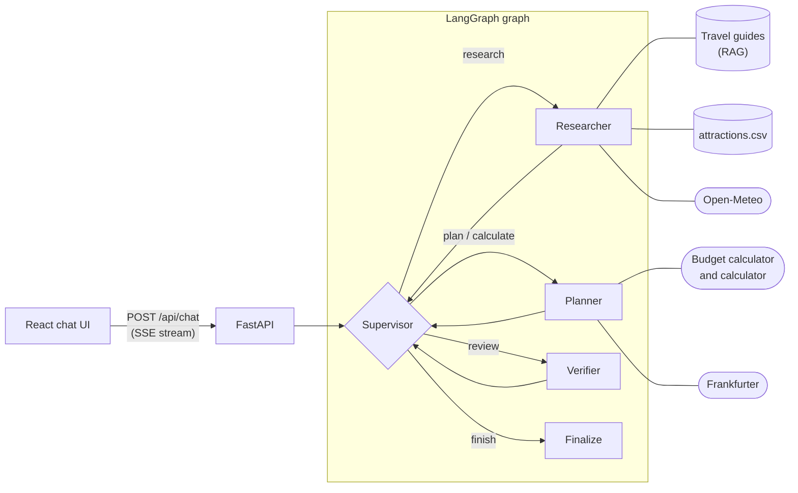

# Wayfinder: a multi-agent travel planner

Wayfinder plans city breaks in Lisbon, Barcelona, Rome, Paris and Stockholm. A **supervisor** agent decides, step by step, which specialist works on a question next: a **researcher** that gathers facts (RAG over travel guides, an attractions database, a live weather API), a **planner** that builds itineraries and budgets (a budget calculator, live exchange rates), and a **verifier** that checks the draft against the user's constraints and the raw tool results, backed by a code-level check that every amount came from a tool. The React chat UI shows the route the agents take while they work.

**Stack:** LangGraph + LangChain 1.x, OpenAI (`gpt-4.1-mini`, `text-embedding-3-small`), FastAPI with Server-Sent Events, React 19 + TypeScript + Vite, Open-Meteo and Frankfurter (free public APIs, no keys).

## Running it

You need Python 3.11+, Node.js 20.19+ (or 22.12+) and an OpenAI API key.

**Backend** (terminal 1):

```bash
cd backend
python -m venv .venv
source .venv/bin/activate        # Windows: .venv\Scripts\activate
pip install -r requirements.txt
cp .env.example .env             # then set OPENAI_API_KEY in .env
uvicorn app.main:app --reload --port 8000
```

**Frontend** (terminal 2):

```bash
cd frontend
npm install
npm run dev                      # open http://localhost:5173 (it proxies /api to port 8000)
```

**Tests** (no API key or network needed; the LLM and the public APIs are replaced by test doubles):

```bash
cd backend && pytest
```

The model, temperature and agent limits are set in `backend/.env` (see `.env.example`). Any chat model with tool calling and structured output works, using LangChain's `provider:model` format.

## Example questions

The first five are also clickable in the UI's start screen.

| Question | Shows | Typical route |
|---|---|---|
| How do I get from Rome's airport to the centre, and what does it cost? | RAG with a city filter and citations | Researcher → `search_travel_guides` |
| Which neighbourhood in Stockholm suits a first visit? | RAG | Researcher → `search_travel_guides` |
| What's the weather in Barcelona over the next three days? | Public API tool | Researcher → `get_weather_forecast` |
| Which museums in Paris are open on Mondays, and what do they cost in SEK? | Structured data, then a second agent and tool | Researcher → `find_attractions` → Planner → `convert_currency` |
| Plan two days in Lisbon this weekend for two people. Our budget for sights is 1,500 SEK, and we prefer indoor sights if it rains. | Full multi-agent collaboration with review | Researcher (forecast, attractions, guides) → Planner (`budget_breakdown`) → Verifier, back to the Planner if the Verifier finds issues |
| *(follow-up)* Make it three days and add a day trip to Sintra. | Conversation memory | Uses the previous turn's plan |
| How much is 2,500 SEK in euros? | Routing straight to the right agent | Planner → `convert_currency` |
| What's the weather usually like in Rome around Christmas? | Choosing RAG over the API | Researcher → guides' climate notes (the forecast only reaches 16 days ahead) |
| Hi, what can you do? / Plan a trip for me. | No agents needed | Supervisor replies, or asks one clarifying question |

## Architecture



One user message runs like this:

1. The UI posts the message with its conversation id (`thread_id`). The API streams progress back as Server-Sent Events.
2. LangGraph appends the message to the thread's history (kept by the checkpointer) and clears the per-turn work log.
3. The **supervisor** reads the conversation and the work log, and returns a structured decision: `{reason, next, task, reply}`. Code-level guardrails can override it (see below).
4. The chosen agent runs with the conversation, the work log so far and its task. Each tool call and result is streamed to the UI and recorded in the work log.
5. Control returns to the supervisor, which picks the next step. This repeats until it chooses `finish`.
6. **Finalize** turns the latest draft into the answer. Only the user's message and that answer are stored in the history.

| Path | Contents |
|---|---|
| `backend/app/graph.py` | Graph state, supervisor, agent and verifier nodes, guardrails, context building |
| `backend/app/prompts.py` | The four role prompts |
| `backend/app/tools.py` | The six tools, grouped by the agent that uses them |
| `backend/app/checks.py` | Code-level checks that budget inputs and every money amount in a draft came from the user or a tool |
| `backend/app/rag.py` | Chunking, embedding and vector search over the guides |
| `backend/app/services/` | Plain-Python services (weather, currency, attractions, budget, calculator) with no LLM code |
| `backend/app/assistant.py` | Composition root: builds the model, knowledge base, tools and graph |
| `backend/app/main.py` | FastAPI app: streaming chat endpoint, conversation history, health check |
| `backend/data/` | Knowledge base (six Markdown guides) and `attractions.csv` |
| `backend/tests/` | Offline tests, including full graph runs with a scripted LLM |
| `frontend/src/` | Chat UI; `RouteTrace.tsx` draws the agents' route from the event stream |

## Agents

| Agent | Responsibility | Built as | Tools |
|---|---|---|---|
| Supervisor | Chooses who acts next and writes their task; decides whether a draft needs review and when to stop; answers greetings and asks clarifying questions itself | LLM call with structured output (`SupervisorDecision`) | None |
| Researcher | Finds facts and cites where each came from | Tool-calling (ReAct) agent from LangChain's `create_agent` | `search_travel_guides`, `find_attractions`, `get_weather_forecast` |
| Planner | Turns research into itineraries and budgets, and does conversions | Tool-calling (ReAct) agent | `budget_breakdown`, `calculator`, `convert_currency` |
| Verifier | Checks the latest draft against the user's constraints and the raw tool results; approves it or lists fixable issues. Code then checks every amount in the draft against the tool results | LLM call with structured output (`Review`) plus a deterministic check | None (it reads the evidence) |

Each agent only gets the tools its role needs: the planner can't look facts up, so it can only plan from evidence the researcher gathered. The verifier is given the raw tool outputs rather than the agents' summaries of them, so a price that changed between research and plan is something it can catch.

## Tools and RAG

| Tool | Type | Source |
|---|---|---|
| `search_travel_guides` | RAG | Six Markdown guides (one per city, plus general trip-planning advice), 46 chunks |
| `find_attractions` | Structured data query | `attractions.csv` (51 attractions): filter by city, category, indoor/outdoor, maximum price, and whether it's open on a given weekday or date |
| `get_weather_forecast` | Public API | Open-Meteo geocoding and daily forecast, for today and the next 15 days |
| `convert_currency` | Public API | Frankfurter daily reference rates, cached for an hour |
| `budget_breakdown` | Computation (+ API) | Per-person prices × travellers, conversion, totals and budget check, in exact decimal arithmetic; returns a finished table |
| `calculator` | Computation | Any other arithmetic, parsed with Python's `ast` module, never `eval` |

**RAG pipeline.** Each guide is split into one chunk per `##` section ("Getting around", "Typical costs"…), because each section answers one kind of question. Every chunk starts with `City — Section` so its embedding carries that context, and it keeps `source`, `section` and `city` as metadata. At startup the chunks are embedded with `text-embedding-3-small` in one batched call and held in LangChain's in-memory vector store. Search returns the top 4 chunks by cosine similarity, optionally filtered by city, so a question about Rome's airport can't return Lisbon's. Each result carries its source, which the agents cite as `(source: rome.md › Getting around)`.

**Whether to use RAG is a decision, not a fixed step.** Retrieval is a tool, so the researcher calls it only when the question needs it: a weather question skips the guides, while "weather around Christmas" uses the guides' climate notes because the forecast doesn't reach that far.

**Failures are information.** Tools return `Error: …` text instead of raising, for both expected problems (a date beyond the forecast range, an unknown city) and unexpected ones. The agent can then retry, fall back to another source, or explain the gap, and one failed call doesn't end the turn.

## How the agents coordinate

- **Supervisor pattern.** Agents never call each other. Every handoff goes through the supervisor, so routing logic lives in one place, the trace is easy to follow, and adding an agent means adding a node and a line to the supervisor's prompt.
- **Shared work log (a blackboard).** The graph state holds a per-turn `work_log`. Every agent run appends `{agent, task, output, tool_calls, verdict}`. The supervisor reads a condensed log to decide what's next, agents read the full log as context, and the verifier gets the raw tool evidence plus the draft.
- **Structured decisions.** The supervisor's routing and the verifier's verdict come back as Pydantic models via structured output, never parsed from free text. The `reason` field comes first, so the model explains before it decides; the UI shows these reasons.
- **Review loop.** When the verifier requests changes, the supervisor sends the work back to the agent that can fix it, quoting the issues in the new task, and usually asks for a second review.
- **Guardrails in code.** The LLM makes the routing decisions, but code enforces limits so every turn ends: at most 6 agent runs and 2 reviews per message, no review without a draft, and at most 12 steps for each agent run. If the last review failed and the limits are reached, the answer is shown with the verifier's concerns attached rather than hiding them.
- **Conversation state.** A LangGraph checkpointer stores each thread's history. Only user messages and final answers go into it; the work log is per-turn scratch space, so follow-up questions stay cheap. The UI restores a conversation after a page reload through `GET /api/threads/{thread_id}`.
- **Streaming.** Nodes emit progress events through LangGraph's stream writer: `route`, `tool_call`, `tool_result`, `agent_output`, `review`, then `final` (or `error`). The API forwards them as SSE, and the UI draws them as a transit-style route.

## Design decisions and trade-offs

- **A supervisor instead of a fixed pipeline.** Each hop costs an extra LLM call, so a full plan with review takes about 10 to 15 calls. In return, simple questions take a one-agent path and only plans that the user will rely on get reviewed.
- **Guarantees in code, not prompts.** Live runs exposed this three times. First the planner wrote budget line items by hand (a few cents off, adjusted to add up) and the LLM verifier approved them. Telling it to use the calculator didn't fix that. Then, given a `budget_breakdown` tool that does the maths in exact decimals, it converted the user's budget to euros by hand and passed in the wrong figure, which the tool echoed back so it looked backed up. So the verifier step now runs two deterministic checks: the budget and prices given to `budget_breakdown` must come from the user's message or the research, and every money amount in the draft (two-decimal numbers, and numbers next to a currency) must match a tool result. Each live failure is replayed as a test. The LLM verifier focuses on what it's good at: constraints, completeness and grounding.
- **Small typed tools instead of generated queries.** The model fills in filter arguments; code does the filtering. That's predictable and safe, and tool errors stay readable.
- **In-memory stores.** 46 chunks and a demo don't justify a vector database or a SQL checkpointer. Both are one-line swaps (for example Chroma or pgvector, and `SqliteSaver` or `PostgresSaver`).
- **Testing orchestration without a model.** A scripted fake LLM drives the real graph, tools and API, so routing, the review loop, limits and memory are tested deterministically, offline, in under a second.

## What I would improve with more time

- **Evaluation.** A set of questions with expected routes, tool calls and answer checks (exact checks plus an LLM judge), run in CI to compare prompts and models.
- **More deterministic checks.** Extend the code-level checks beyond amounts: closing days against the attractions data, dates against the forecast, and the travellers count against the request.
- **Better retrieval.** Hybrid search (BM25 plus embeddings), re-ranking, a relevance threshold to drop weak matches, and more sources.
- **Parallel research.** Fan out independent lookups (weather, attractions, guides) with LangGraph's `Send` API to cut latency.
- **Answer streaming.** Stream the final answer token by token. Today it arrives in one piece because only reviewed drafts are shown.
- **Production concerns.** Persistent storage, authentication with per-user threads, rate limiting, retries with backoff for external APIs, tracing and cost tracking (for example LangSmith), and Docker Compose.
- **Human in the loop.** Use a LangGraph interrupt to confirm assumptions such as dates and budget before planning.
