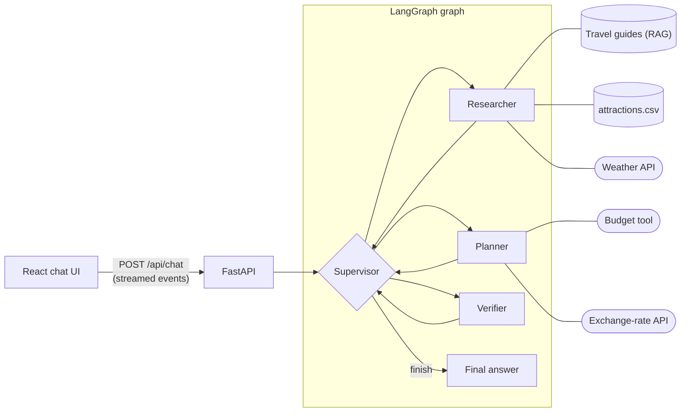

# Wayfinder: a multi-agent travel planner

A chat assistant that plans city breaks in Lisbon, Barcelona, Rome, Paris and Stockholm. A **supervisor** decides which agent works on each step: a **researcher** finds facts, a **planner** builds itineraries and budgets, and a **verifier** checks the result before it reaches the user.

**Stack:** LangGraph, LangChain, OpenAI (`gpt-4.1-mini` and `text-embedding-3-small`), FastAPI, React + TypeScript (Vite). Live data comes from Open-Meteo (weather) and Frankfurter (exchange rates), which need no API keys.

## How to run it

You need Python 3.11+, Node.js 20.19+ and an OpenAI API key.

```bash
# Terminal 1: backend
cd backend
python -m venv .venv
source .venv/bin/activate          # Windows: .venv\Scripts\activate
pip install -r requirements.txt
cp .env.example .env               # then add your OPENAI_API_KEY
uvicorn app.main:app --reload --port 8000

# Terminal 2: frontend
cd frontend
npm install
npm run dev                        # open http://localhost:5173
```

Tests run offline, without a key: `cd backend && pytest`.

## Example questions

| Question | Shows |
|---|---|
| How do I get from Rome's airport to the centre, and what does it cost? | RAG: the researcher searches the Rome guide and cites it |
| What's the weather in Barcelona over the next three days? | Tool use: live weather API |
| Which museums in Paris are open on Mondays, and what do they cost in SEK? | Two agents: researcher queries the attractions data, planner converts prices |
| Plan two days in Lisbon this weekend for two people. Our budget for sights is 1,500 SEK, and we prefer indoor sights if it rains. | All agents: research → plan → review, and back to the planner if the review fails |
| *(follow-up)* Make it three days and add a day trip to Sintra. | Conversation memory |
| Hi, what can you do? | No agents needed: the supervisor answers directly |

## Architecture



For each user message:

1. The supervisor reads the conversation and what has been done so far, and picks the next agent (or decides to finish).
2. That agent works on its task with its own tools. Every tool call and result is streamed to the UI.
3. Control returns to the supervisor. This repeats until the answer is ready.
4. The final answer is saved in the conversation history.

| File | What it does |
|---|---|
| `backend/app/graph.py` | The LangGraph graph: supervisor, agents, verifier, limits |
| `backend/app/prompts.py` | The instructions for each agent |
| `backend/app/tools.py` | The five tools |
| `backend/app/rag.py` | Splitting, embedding and searching the travel guides |
| `backend/app/checks.py` | Code checks that every money amount came from a tool |
| `backend/app/services/` | Weather, currency, attractions and budget logic (no LLM code) |
| `backend/app/main.py` | The API: chat endpoint and conversation history |
| `backend/data/` | The six guides and `attractions.csv` |
| `frontend/src/` | The chat UI; `RouteTrace.tsx` shows the agents' steps |

## Agents

| Agent | Job | Tools |
|---|---|---|
| Supervisor | Decides who works next and when the answer is done. Answers greetings and asks clarifying questions itself. | None |
| Researcher | Finds facts and says where each one came from. | `search_travel_guides`, `find_attractions`, `get_weather_forecast` |
| Planner | Turns the research into a day-by-day plan and a budget. | `budget_breakdown`, `convert_currency` |
| Verifier | Checks the draft against the user's request and the tool results; approves it or lists problems. | None |

The supervisor and verifier return structured output (Pydantic models), so routing decisions are never parsed from free text. The researcher and planner are tool-calling agents built with LangChain's `create_agent`.

## Tools and RAG

| Tool | Type |
|---|---|
| `search_travel_guides` | RAG over six Markdown guides |
| `find_attractions` | Query structured data: filter 51 attractions by city, category, indoor/outdoor, price and opening day |
| `get_weather_forecast` | Public API (Open-Meteo), up to 16 days ahead |
| `convert_currency` | Public API (Frankfurter) |
| `budget_breakdown` | Calculation: prices × travellers, currency conversion, totals and budget check |

**RAG:** each guide is split by its `##` sections (for example "Getting around"), embedded once at startup, and kept in memory. A search returns the 4 most similar sections, optionally only from one city, and every result carries its source so the answer can cite it. Searching the guides is a tool, so the researcher decides when it's needed: a weather question doesn't use it.

## How the agents coordinate

- **Through the supervisor.** Agents never call each other directly; every step goes through the supervisor.
- **A shared work log.** Each agent's task, tool calls and result are added to a work log in the graph state. The supervisor reads it to decide the next step, and the next agent reads it as context.
- **A review loop.** If the verifier finds problems, the supervisor sends the work back to the planner or researcher with the problems listed.
- **Limits in code.** At most 6 agent runs and 2 reviews per message, so a turn always ends. If the last review still failed, the answer is shown with the verifier's concerns attached.
- **Memory.** A LangGraph checkpointer keeps each conversation's history by `thread_id`, so follow-up questions work.

## Design decisions

- **A supervisor rather than a fixed pipeline.** Simple questions use one agent; only plans with numbers get reviewed. The cost is extra LLM calls: about 10–15 for a full reviewed plan.
- **Numbers are computed and checked in code.** In live testing, the planner did budget arithmetic in its head (a few cents off) and the LLM verifier approved it, even when told to use a calculator. So `budget_breakdown` does all the maths, and `checks.py` rejects any draft containing an amount that doesn't come from a tool or the user. Those live failures are now tests.
- **Small tools with typed arguments.** The model fills in filters; code does the work. That's predictable and easy to test.
- **In-memory storage.** Enough for a demo with 46 text sections. A vector database and a persistent checkpointer would be simple swaps.
- **Tests without a real model.** A scripted fake LLM drives the real graph, tools and API, so the orchestration is tested offline in about a second.

## What I would improve with more time

- An evaluation set of questions with expected routes and answers, run automatically to compare prompts and models.
- More code checks: closing days, dates and traveller counts, not only amounts.
- Better retrieval: keyword plus vector search, and dropping weak matches.
- Running independent research steps in parallel to cut waiting time.
- Production work: persistent storage, user accounts, retries for the external APIs, monitoring and cost tracking.

Built with the help of an AI coding assistant (Claude), as the brief allowed.
